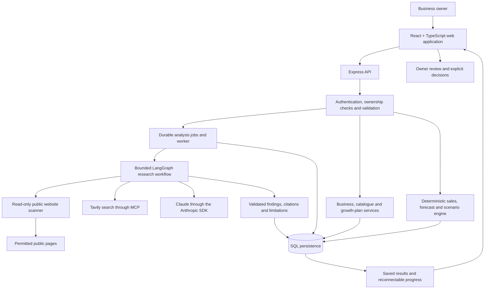

# GrowthPulse

### An evidence-first AI growth partner for small businesses

GrowthPulse helps business owners turn scattered website information, product listings, customer feedback and sales records into a clearer answer to one question:

> **What should I improve next, and what evidence supports that decision?**

It combines agent-led business research, a source-backed product catalogue, an actionable growth plan and a sales simulator in one guided workspace. AI helps interpret qualitative evidence; deterministic calculations handle sales metrics and scenarios. Owners stay in control of business decisions and website changes.

**Public project showcase:** This repository documents the product and its architecture. Application source code is maintained separately.

| Explore | Link |
| --- | --- |
| Live application | To be added |
| Demo video | To be added |

## The problem

Small businesses often have information everywhere but a clear next step nowhere.

- Their website describes the business, but does not explain where to focus improvement.
- Product information is scattered across spreadsheets, websites and marketplace listings.
- Competitor research and customer feedback take time to collect and verify.
- Sales exports show what happened, but exploring a decision usually means building another spreadsheet.
- Generic AI advice can sound convincing without showing its sources or acknowledging missing information.

GrowthPulse connects **understanding, evidence, decisions, action and review** rather than presenting another disconnected dashboard or an unrestricted chatbot.

It is designed for small retailers, direct-to-consumer brands and independent sellers. Businesses without websites can still enter products and use sales analysis through manual records or file imports. Selling through a social channel does not require granting GrowthPulse access to private messages.

## The product experience

**Understand -> Discover -> Decide -> Act -> Review**

1. **Understand the business.** Create a business profile and, where available, provide a public website. With permission, the agent invokes a read-only scanner and prepares a sourced business draft.
2. **Discover relevant evidence.** Review business findings, potential competitors, published pricing and eligible customer-feedback samples. Sources and evidence gaps remain inspectable.
3. **Decide what to try.** Turn accepted findings into growth opportunities and choose recommendations for a saved plan.
4. **Act deliberately.** Use an execution workspace with next steps, owner-reported progress and optional product or simulator context.
5. **Review what happened.** Import sales, explore assumptions and record observed outcomes without presenting correlation as proof that an action caused growth.

## Core capabilities

| Capability | What it provides |
| --- | --- |
| **Agent-led onboarding** | Guided business understanding using the scanner as a tool, with evidence-backed drafts and owner review of profile changes. |
| **Unified product catalogue** | Manual entry, CSV imports and supported structured website product data, with reviewed matching and separate source listings. |
| **Market intelligence** | Bounded competitor discovery, public-source verification, published-price comparisons and customer-feedback analysis where eligible evidence exists. |
| **Product intelligence** | Evidence-backed product diagnosis, listing and SEO drafts, and recommendations for owner review rather than automatic publishing. |
| **Growth plan and actions** | Saved opportunities, practical next steps, measurement context and explicit action-status updates. |
| **Growth Simulator** | CSV/XLSX sales imports, editable column matching, import previews, explicit confirmation, historical metrics, dated forecasts and saved what-if scenarios. |
| **Weekly review pilot** | Sales comparisons and action-outcome reviews based on imported or manually recorded observations. |

### A simulator that separates facts from assumptions

The simulator has three distinct responsibilities:

- **My sales:** historical results from accepted imports and owner-entered records.
- **Forecast:** a dated 30-day statistical outlook when sufficient observed history exists.
- **What if?:** a copy of historical results with owner-selected assumptions, such as different order volume, average order value or unit costs.

Common sales columns are matched automatically; ambiguous fields are brought back to the owner. A preview never commits an import. Saved scenarios preserve their baseline and can link back to a growth-plan action.

Missing dates remain unknown rather than becoming zero sales. Scenarios do not modify actuals, and hypothetical improvements are not promises of future revenue.

## System architecture

### Application layers

| Layer | Technologies and responsibilities |
| --- | --- |
| **Frontend** | React, TypeScript and Vite; Tailwind CSS, Radix/shadcn-style components and Recharts for responsive workspaces and data visualization. |
| **API and domain services** | Node.js and Express; authenticated business workspaces, catalogue management, imports, research admission and action tracking. |
| **Contracts and validation** | Shared TypeScript types and Zod schemas for request, response and structured-model validation. |
| **Agent orchestration** | LangGraph coordinates bounded research steps; the official Anthropic TypeScript SDK handles model requests. |
| **Research tools** | A permission-aware public website scanner and Tavily discovery through the Model Context Protocol SDK. |
| **Persistence** | SQLite for local development; MySQL-backed repositories and migrations for the production configuration. Jobs, findings, checkpoints and business records are persisted. |
| **Quality assurance** | Vitest, React/jsdom interaction tests, Supertest API tests, isolated database fixtures and synthetic browser checks. |

### The research workflow

The agent is a coordinated workflow, not an unlimited loop of model calls:

1. **Store intelligence** establishes what the business actually says about itself.
2. **Competitor intelligence** discovers candidates and verifies relevant public evidence before making comparisons.
3. **Customer intelligence** uses eligible, confirmed review evidence rather than treating brand marketing as customer sentiment.
4. **Pricing intelligence** compares captured published prices deterministically, without inventing sales volumes or market share.
5. **Product opportunities** connect accepted observations to possible improvements.
6. **Growth strategy** turns those findings into proposals the owner can evaluate.

Specialist findings retain citations and limitations. A failed or partial check is represented as such; it does not silently become a confident conclusion.

## Engineering decisions

### Evidence before advice

Research findings retain their supporting sources. Unknowns, insufficient samples and unverified competitor candidates are distinguished from accepted observations. AI-generated interpretations are not treated as independent evidence.

### Durable work, lightweight infrastructure

Long-running analysis uses SQL-backed jobs, renewable worker leases and persisted graph checkpoints rather than depending on an open browser tab. Reopening a saved result reconnects to existing work instead of starting another paid analysis.

The worker runs within the Node.js application process; a separate Redis service is not required. Cancellation and stale-worker protections prevent late work from overwriting an accepted outcome. Interrupted work requires an explicit retry: recovery is not a guarantee of exactly-once provider billing.

### AI for interpretation, code for arithmetic

Business and product research use language models where interpretation is useful. Import matching, validation, sales aggregation, statistical forecasting and scenario arithmetic use deterministic code. This keeps financial calculations explainable and avoids spending model calls on routine computation.

### Source provenance without overwriting owner intent

Canonical products and their source listings are stored separately. Imports and rescans can contribute evidence without silently replacing manual product edits. Accepted sales observations and saved scenario baselines preserve the context needed to interpret later reviews.

### Useful progress instead of exposed debug logs

The interface shows actual stages, meaningful counts and actionable failures. Raw research queries, scanner diagnostics and detailed import notes are available on demand rather than dominating the customer experience.

## Safety and privacy boundaries

- **Read-only website access:** public-network checks, DNS pinning, redirect validation, robots rules and bounded page, response-size and runtime budgets.
- **No bypasses:** no private-network scanning, login bypass, challenge bypass or authenticated website scraping.
- **Owner isolation:** authenticated access and business-ownership checks protect saved workspaces and research.
- **Server-side credentials:** provider keys stay on the server and are not shipped to the browser.
- **Explicit decisions:** permissions and provider-charge disclosures precede relevant work; imports require confirmation; recommendations do not automatically publish changes.
- **Data minimization:** sales imports retain normalized summaries rather than raw workbooks or individual customer/order identifiers.
- **Untrusted external content:** scanned pages and imported evidence are data to validate, not instructions that can override the workflow.

## Current scope and limitations

GrowthPulse is an evolving full-stack product prototype. The capabilities described above include local development work; they are not a claim that every feature is available in a public deployment.

- The public repository is a documentation showcase, not a runnable source-code distribution.
- Website and marketplace research is a bounded sample, not exhaustive market coverage.
- Forecasts require sufficient historical observations; their illustrative uncertainty bands are not calibrated.
- Weekly growth review currently uses CSV/manual observations, not an automatic sales connection.
- Native Instagram/WhatsApp account access, private-message ingestion, unattended monitoring and automatic website publishing are not implemented.
- Action outcomes are observations with caveats, not proof of causal revenue uplift.

## Demo walkthrough

A short demo can follow one complete decision journey:

**Create a business -> review sourced findings -> inspect a product -> choose a growth action -> import sales -> explore a what-if scenario -> review progress.**

Demo video and live application links will be added above.
